# AutoCAD working assembly

Open [PitchComm-v20-solids.dwg](PitchComm-v20-solids.dwg) in AutoCAD. Revision `v20-pitcher-wire-clearance` contains 34 editable printed-part solids and 26 component reference solids. Units are millimetres; the units start at x=0, 65 and 130. Each `PART_<filename>` layer holds one assembled part. `REF_<unit>_<component>` layers start hidden. Use the matching [print guide](../unbranded/README.md) for orientations, quantities and assembly.

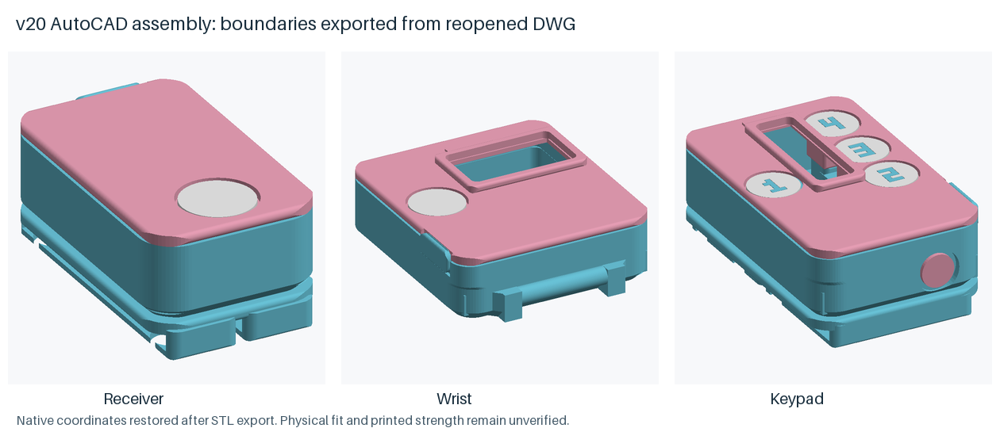

Sixteen printed parts use native extrusions and Boolean construction, including all decks and the pitcher body; eighteen convert from validated meshes. Faceted contours are preserved. The [v19 drawing](PitchComm-v19-solids.dwg) and [v18 drawing](PitchComm-v18-solids.dwg) remain available for comparison.

## Pitcher four-wire clearance release

Revision v20 moves the pitcher cell reservation and its bay rails 1 mm toward the front and adds a 2.4 x 2.2 mm R0.6 wire passage in its deck at x=5.2, y=22.8. Replace the pitcher body and deck together when upgrading v19; the other 32 printed-part shapes and fit coupon are unchanged. Outside size, PCB/USB height, walls, floors, fastening and mounting stay the same. Calculated material changes by +1.296 mm³; actual mass and strength are unmeasured. The small functional passage retains the checked 3 mm stock margin and cell-cover/post/ledge/screw lands. Large lightening openings keep R1.5 corners.

The pitcher four-wire model clears assumed 0.6 mm insulated cell leads with R0.6 centerline bends, alongside the existing board-side pair. Watch and catcher conditional four-wire studies also pass at their documented assumed sizes. These are short geometric paths: they do not accommodate all supplied factory lead length or establish retention, soldered fit, unplugging or wired case opening. No factory harness cutting is proposed. Wider pitcher cell leads are unqualified.

The updated complete drawing passes 60 native solid checks, zero drawing audit errors, 78 empty nominal component intersections and 34 unrepaired saved-drawing STL boundary comparisons. The changed pitcher geometry passes fresh interface checks; unchanged geometry and retained-stock witnesses provide explicit reuse across 14 audit scopes. This is not 14 new executions of the historical audit scripts. Enlarged underside solder masks retain some inherited body contacts outside the nominal PCB outline; the deck masks clear and no body contact increases. Actual solder and hardware fit remain unverified.

## Battery and underside wiring space

The protected-cell reservation is 12.7 x 32.4 x 4.3 mm, covering the supplier-linked older 12.3 x 32 x 4.3 mm maximum pack box with 0.2 mm nominal allowance on each XY side and 0.2 mm beneath the deck. Its relationship to a currently delivered cell is unverified. The pitcher keeps its original bay left edge to preserve a screw bearing; the watch bay moves away from the front wall; the catcher pack moves 0.4 mm right to clear call 1. No pouch corner shape or foam compression is assumed for the maximum-box check.

PCB-to-deck gaps are 2.05 mm pitcher/watch and 2.4 mm catcher. Board and USB opening move upward together; support centers, screw positions, strap channels, 1.4 mm floors and 2 mm walls stay fixed. Flat height is 14.8 mm pitcher/watch and 15.3 mm catcher: +1.8/+1.8/+0.5 mm from v18. Calculated full-set material increases by 711.123 mm³ (6.4%), 843.118 mm³ (7.4%) and 293.061 mm³ (1.6%). These are geometric costs, not measured mass or strength.

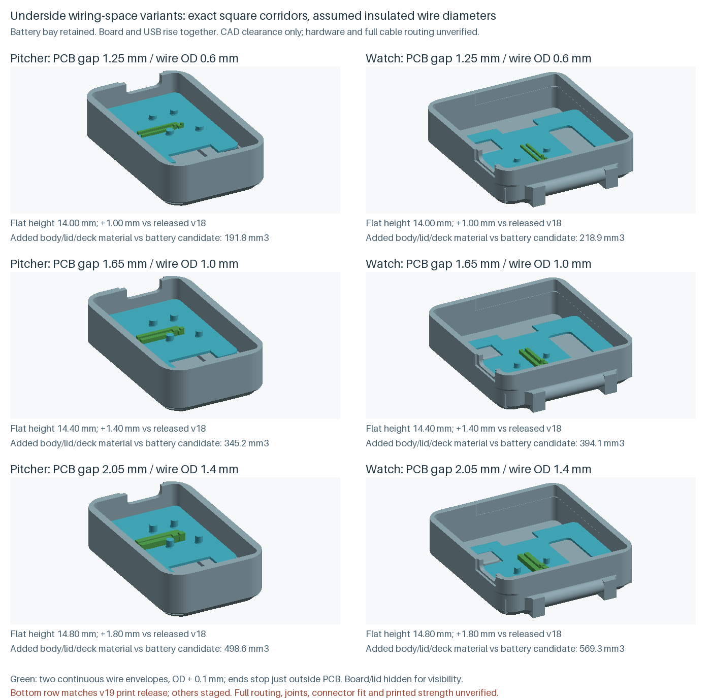

The comparison shows tested 1.25/1.65/2.05 mm gaps. The 2.05 mm option covers the widest tested 1.4 mm assumed insulated diameter; it is the current release. Smaller options remain staged. Actual cable and joint dimensions are unknown, and these tests do not prove a globally minimum enclosure size.

Continuous square wire-envelope checks clear assumed insulated diameters of 0.6, 1.0 and 1.4 mm with 0.05 mm per-side allowance in every unit. They retain other solder-pad reservations, posts and the metal-free antenna band. The planner now uses square dilation to match the checked square envelope; its previous rounded mask admitted some corner paths that failed final continuous contact checks. The final 0.001 mm³ contact limit is unchanged, and prior failures are preserved.

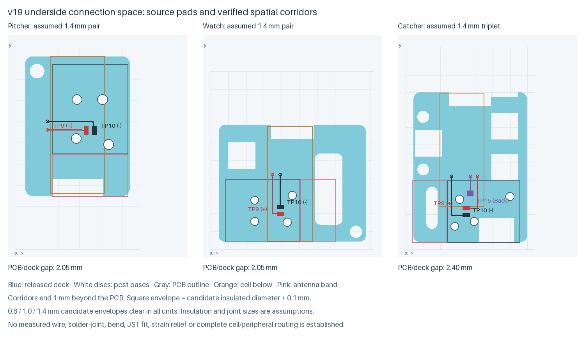

The paths end just beyond the PCB. They do not establish full battery/JST/OLED/switch routing, solder-joint shapes, bends, strain relief or unplugging access. Wire diameter is an assumption, not a measurement or a confirmed cable specification.

## Matching printed parts

For the historical v18-to-v19 upgrade, replace all three bodies and decks, the pitcher/watch lids and the fit coupon. The taller pitcher/watch lids extend their screw bosses down to the deck datum. Use each matching body/lid/deck set together. Catcher lid, charge caps, carriers, bezels, buttons and numeral inlays are unchanged prints. Seventeen of 69 STL files change, including color copies; 52 remain byte-identical.

The retained watch/catcher rounded deck openings are 7.7 x 20 mm at x=29.3, y=7 on the watch and 3.2 x 12 mm at x=5.9, y=6 on the catcher. Both use R1.5 corners and retain 3 mm stock margins, cell covers, post bases, ledges and screw lands. The openings do not make the antenna band available for wiring.

## PCB mounting

The manufacturer PCB review found four old lid pads occupying front-side courtyards for 20 components per style, including ANT1. Four deck posts now seat the PCB from below, with 2 mm bearing tops and 2.4 mm widened bases. The geometric PCB center stays within the support-center polygon, with at least 0.83 mm margin. All 79 front courtyards per style are reserved at an assumed 2 mm height; underside solder reservations remain 0.5 mm high with 0.2 mm XY allowance. Physical component heights, retention and RF behavior remain unmeasured.

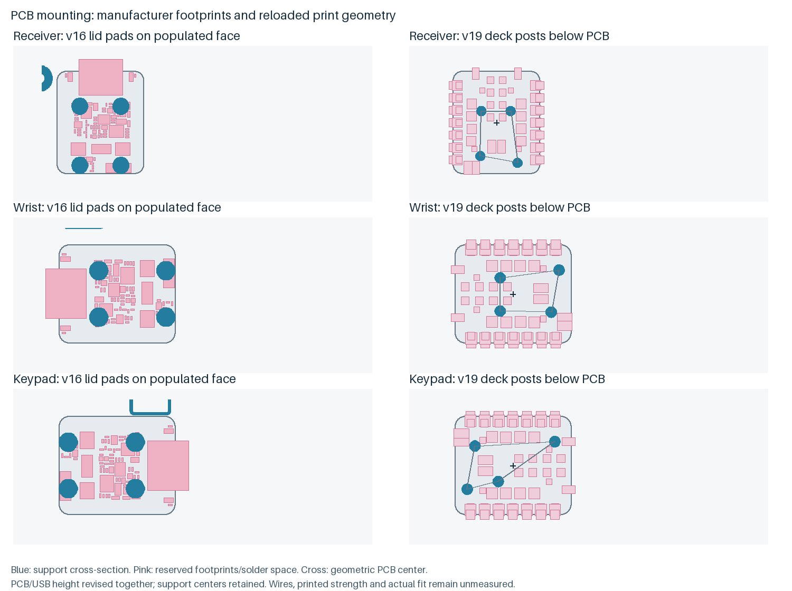

Solder TP9 (VBAT), TP10 (GND) and catcher TP15 (D13/P2.10) leads before fixing the board to its posts. These are manufacturer file reference names, not assumed silkscreen labels. D13 is absent from the standard 1x7 header set. Trim header pins flush for the cased build. Bare and pre-soldered boards use the same post-top datum; adding a PCB shim changes USB alignment. Keep adhesive off bearing tops, pads and test points.

## Power and connector compatibility

The current parts list specifies the Adafruit 3814 male mating cable; the previous 261 cable had the same connector half as the cell. The compatible 3814 housing is not a genuine JST part and its full mated dimensions remain unverified. A genuine PHR-2 drawing covers only the female crimp housing. Delivered protected-pack, housing, insulated leads and unplugging access still need physical checks.

The reviewed XIAO uses U1 SGM40567-4.2 and R4=120 kOhm for 200 mA USB charging, above the specified cell's 100 mA limit. Firmware cannot control the source IREF net. **Disconnect the cell before any USB connection to the board**, including flashing, console and bench use. Charge it separately, off-body, with Micro-Lipo 1304 at 100 mA; do not select 500 mA. Follow the [wiring reference](../../docs/wiring.md) and print guide for polarity, case opening and charging. These power instructions remain unchanged by the CAD revision.

## Conditional connector service space

A staged study finds space in each current case for an explicitly assumed 5 x 8 x 4 mm package with 0.2 mm allowance per side: a 5.4 x 8.4 x 4.4 mm rectangular reservation. These are test inputs, not dimensions of the Adafruit 3814 cable or its mated connector. No print geometry changes result from this study.

| Case | Reservation lower corner x / y / z (mm) | Clear 5 mm horizontal test moves |
|---|---|---|
| Pitcher | 2.20 / 24.90 / 7.05 | Either direction along y |
| Watch | 10.80 / 30.30 / 7.05 | Negative x; positive y |
| Catcher | 5.60 / 40.90 / 7.05 | Either direction along y |

Continuous Boolean checks clear each selected reservation against the intact serialized body, lid and deck, nominal electronics, cell reservation, other solder reservations and an antenna exclusion extended through the service movement. With only the lid omitted, each box also clears a 25 mm upward lift and the listed 5 mm translations while the board and deck remain installed. These movement checks **exclude attached wires**; they do not establish unplugging access with a completed harness. The search uses 0.1 mm planning cells, followed by exact finite contact checks; earlier 0.5 mm misses are preserved. It checks selected poses and does not prove a maximum package size or global impossibility of other poses.

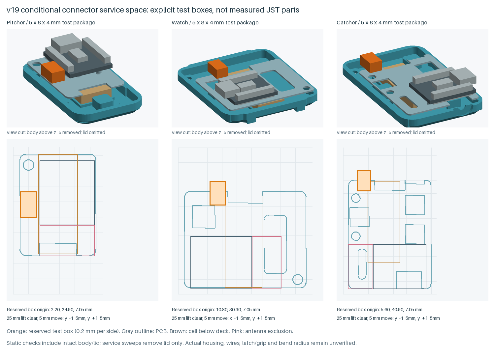

The preview cuts the body at z=5 mm for visibility; the checks use the intact body. Full wire routes, housing mating direction, latch, finger/tool grip, service slack and strain relief remain unresolved. These boxes are starting points for routing and access variants, not assembly instructions or a physical connector-fit claim. The release report preserves both the coarse survey of 5 x 8 x 4, 6 x 10 x 5 and 8 x 12 x 6 mm test packages and the refined smallest-package study.

## Paired battery-wire routing

A further staged study checks the connector reservation and both board-side battery wires together. It finds paired static paths from the manufacturer's TP9 (VBAT) and TP10 (GND) to two **assumed** test-box ports in all three styles for 0.6 mm insulated wire diameter. Each square corridor is 0.7 mm wide, including 0.05 mm clearance allowance per side; the port spacing is an assumed 2 mm. The paths permit contact only at their own solder attachment reservation and designated connector entry. Other solder pads, intact body/lid/deck, nominal electronics, cell reservation and antenna band stay clear. The catcher also retains its separate Back-wire escape reservation.

The old pitcher escapes overlapped this connector box by about 0.142 mm³ per wire at the 0.6 mm assumption. Validating the bay and short escapes separately therefore did not prove their combined placement. The new paired paths avoid that overlap. None of these tests establishes the actual Adafruit 3814 housing, lead exit or cable diameter.

| Assumed insulated diameter | Pitcher | Watch | Catcher |
|---|---|---|---|
| 0.6 mm | Paired static paths found | Paired static paths found | Paired static paths found |
| 1.0 mm | Paired static paths found | Paired static paths found | Unresolved in tested poses |
| 1.4 mm | Unresolved in tested poses | Paired static paths found | Unresolved in tested poses |

Larger-wire failures are retained as search results, not proof that no route exists. A short escape passing at 1.4 mm does not establish a complete connector route at that diameter. Twelve successful staged wire-envelope STLs reload as watertight single shells with consistent winding; their continuous case/component/pair-clearance checks pass under 0.001 mm³. Coincident-wire and antenna-collision negative controls confirm that overlaps are detected.

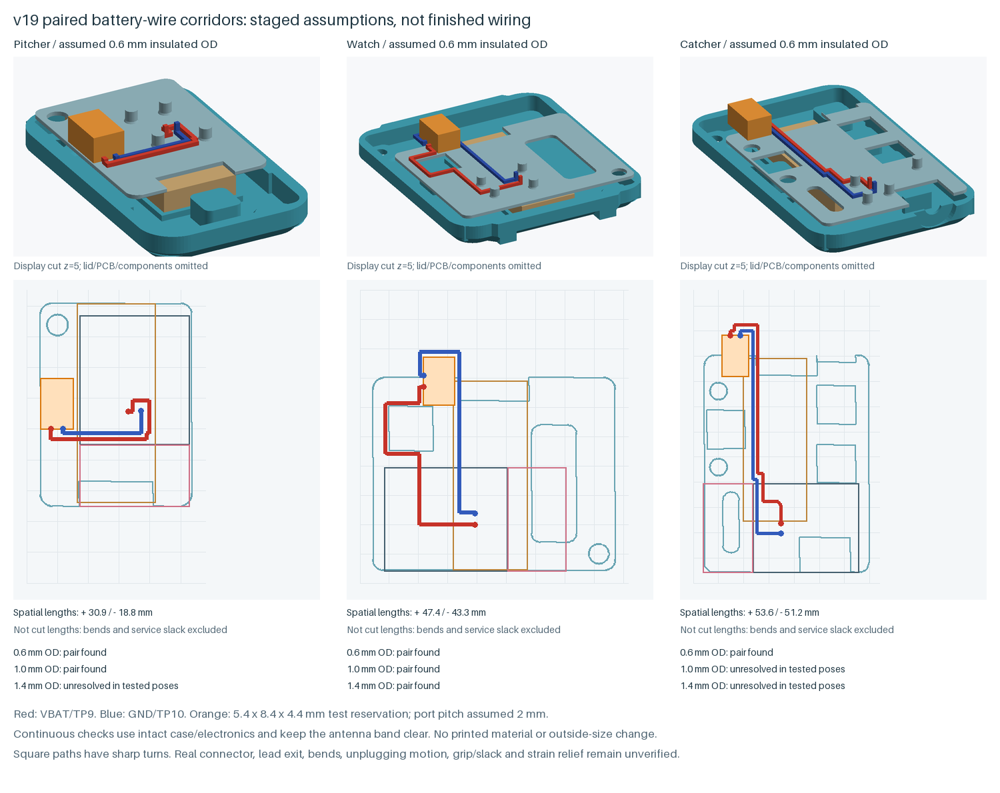

The display cuts the body and omits the lid/PCB/components to expose the paths; clearance checks retain them. The shown lengths are spatial path lengths, **not cut lengths**. Square paths have sharp turns and small planning-grid offsets, so they do not establish a usable bend radius. Cell-to-connector leads, wire retention, service slack, grip/latch direction and wired opening/unplugging motion remain unresolved. This is engineering evidence, not finished assembly routing. Printed-part material volume and outside dimensions change by zero; the released STLs, 3MFs, drawing and both print packs remain unchanged.

## Rounded battery-wire bends

An initial rounded study replaces sharp corners with explicit circular centerline bends. For the same assumed 0.6 mm insulated diameter, paired board-to-test-box paths pass at **0.6 and 0.9 mm centerline bend radii** in the pitcher and watch. The radius and connector ports remain design assumptions, not a cable bend rating or measured Adafruit 3814 geometry. The modeled tube includes 0.05 mm radial allowance and 0.002 mm allowance for the curved surface approximation. End faces represent assumed attachment planes.

| Rounded routing variant | Pitcher | Watch | Catcher |
|---|---|---|---|
| R0.6 mm, default plane | Paired paths pass | Paired paths pass | Unresolved |
| R0.9 mm, default plane | Paired paths pass | Paired paths pass | Unresolved |
| R0.6 mm, higher catcher plane | Not retested | Not retested | Unresolved |
| R0.6 mm, mirrored catcher ports | Not retested | Not retested | Unresolved |

Eight exported tube models reload as closed, consistently wound single shells. Source-minus-export, export-minus-source and self-subtraction checks return zero volume; continuous intact case/component/other-wire checks remain under 0.001 mm³. Their interiors contain all 25,600 independently sampled circular bend-envelope surface points. Tube volumes agree with cross-sectional area times analytic path length within 0.062%. Separate controls cover three radii, 18 bend orientation cases and a known self-overlapping route that must be rejected.

The initial swept models were rejected because an arbitrary frame rotation could twist otherwise closed tubes. A later grid route was also rejected for looping through its own corridor. Both failed studies remain preserved outside the release; closed meshes and separate bay clearances alone do not establish valid wiring. The final sweep preserves cross-section orientation and rejects the tested self-overlap before selecting a pair.

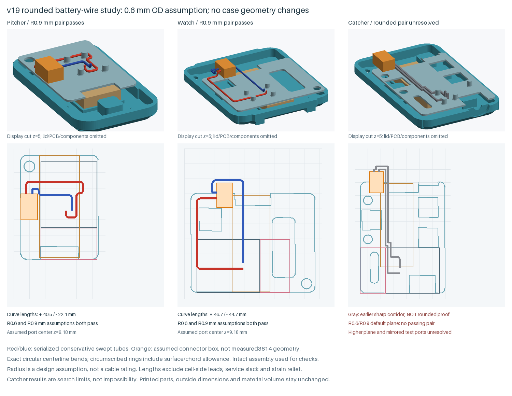

Gray catcher paths show the earlier sharp corridors, not passing rounded routes. Its failures include blocked second-wire searches and OLED contact; raising the plane or mirroring the test ports did not resolve them. The greedy search and final-heading constraints do not prove that no rounded pair exists. The subsequent split-height backtracking study below resolves a conditional catcher pair.

Lengths are spatial curve lengths, **not cut lengths**. Cell-side leads, service slack, grip/latch direction, strain relief and wired opening/unplugging motion remain unresolved. The connector movement study still excludes attached wires. This supplement changes no printed-part material, dimensions, STLs, 3MFs, drawing or print packs; actual fit and printed strength remain unverified.

## Split-height catcher wire route

A subsequent backtracking study finds a rounded catcher pair in the **existing case** using different routing heights. TP9 (VBAT) follows a plane at z=7.18 mm; TP10 (GND) follows z=7.98 mm, a 0.80 mm separation. Both reach the same assumed connector face at z=9.38 mm with 2 mm port spacing. The insulated diameter remains an assumed 0.6 mm, and every centerline bend uses R0.6 mm. No enclosure height or printed stock is added.

The first assignment put TP9 high and TP10 low; it failed the expanded other-wire check with about 0.286 mm³ overlap. Swapping the height assignment clears both wires. Forty backtracked same-plane attempts remain unresolved. This shows why planar crossings and a greedy first route were insufficient; it does not prove a global minimum route or an actual connector fit.

Both exported tube models pass closed-shell, winding, both source/export boundary directions and self-subtraction checks. All modeled intact case/electronics/other-terminal/Back-wire/antenna/expanded other-wire contacts are zero volume. All 4,608 independent bend-envelope surface samples are contained, with tube-volume error below 0.015% relative to cross-sectional area times analytic curve length. Controls reproduce the failed height assignment, coincident-wire and antenna collisions; a planar short-leg fixture is also rejected after its vertical attachment bends are added.

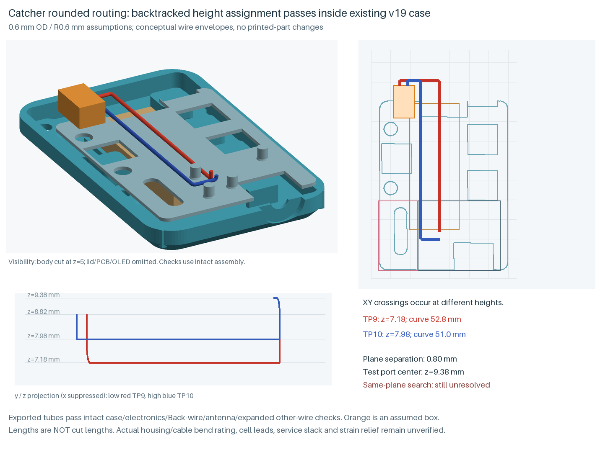

The preview cuts the body and omits the lid/PCB/OLED for visibility; the checks retain them. The y/z projection suppresses x, so projected overlaps do not imply contact. Curve lengths are about 52.8 mm for TP9 and 51.0 mm for TP10, **not cut lengths**. These are conditional board-side paths only. Cell-side leads, real cable/housing dimensions and bend rating, wire retention, service slack, grip and wired opening/unplugging motion remain unresolved. The earlier box-movement study still excludes wires.

Conditional rounded battery-wire pairs now exist in all three styles under the tested assumptions. This evidence supplement preserves the released STLs, 3MFs, drawing, dimensions, material volume and both print packs. Physical fit, printed strength and hardware performance remain unmeasured.

## Battery-side watch leads

A further study adds the two cell-side leads while retaining both checked board-side wires. The watch has a conditional four-wire layout for **0.6 mm cell-lead diameter with R0.6 mm bends**, and for **1.0 mm cell-lead diameter with R1.0 mm bends**. The board-side pair stays at its earlier 0.6 mm/R0.6 mm assumption. A 1.4 mm cell-lead pair remains unresolved in the tested poses.

The cell is oriented with its leads toward positive y. Two assumed exit points are 2 mm apart at the midpoint height of the maximum rectangular reservation, z=3.75 mm. They rise beyond the existing rear deck edge and reach the opposite face of the connector test box at z=8.58 mm. Constraining the approach direction and providing enough straight length for the full 3D bends resolves the earlier greedy pair failures. These port coordinates and insulation diameters are assumptions. The [older supplier drawing](https://cdn-shop.adafruit.com/product-files/1570/1570datasheet.pdf), page 5, shows short-edge exits and UL1007 26-gauge conductors; that does not establish delivered insulation diameter or bend rating. The [current product page](https://www.adafruit.com/product/1570) and this older drawing do not qualify the modeled exit pitch/height or mated housing.

Four cell-wire exports pass closed-shell, winding, both source/export boundary directions and self-subtraction checks. Each variant has all six pair combinations of its four wires checked with zero modeled overlap. Intact body/lid/deck, nominal electronics, board-wire clearance envelopes, cell reservation outside the assigned exit, other attachment regions and the extended antenna band stay clear. All 8,192 independently sampled circular bend-envelope surface points are contained; tube-volume error is below 0.075% relative to area times analytic curve length. Wider tubes use a matching full-surface approximation bound rather than reusing a thin-wire bound.

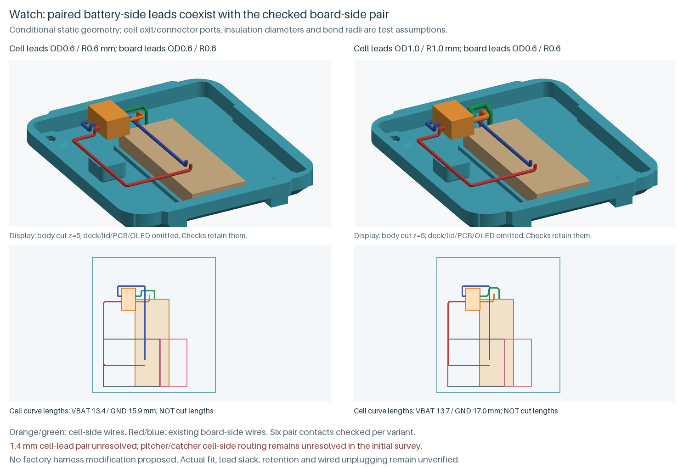

The initial 0.6/1.0/1.4 mm surveys found no complete pair in any style. Subsequent watch height and ramp experiments remained unresolved; the successful approach-constrained variants above are separate checked evidence. Tested straight short-edge lifts in pitcher and catcher hit body/deck, existing wires or reserved regions, or fail the upper search. The subsequent catcher study below resolves a conditional 0.6 mm pair. Pitcher cell-side routing remains unresolved; those failures do not prove no route exists.

The view omits deck/lid/PCB/OLED for visibility; clearance checks retain them. Curve lengths are spatial lengths, **not cut lengths**. No cutting or alteration of the factory battery harness is proposed. Its supplied slack, real connector fit, wire retention, strain relief and wired opening/unplugging still need qualification. Printed parts, material volume, outside size, drawing and both print packs remain unchanged.

## Battery-side catcher leads

A subsequent study finds a conditional catcher four-wire layout in the existing enclosure, with all four leads modeled at **0.6 mm insulated diameter and R0.6 mm centerline bends**. The board pair keeps its checked split routing heights, z=7.18 and 7.98 mm. The cell is oriented with its leads toward positive y; assumed exits are 2 mm apart at z=3.75 mm on the short edge. This remains a test pose, not a measured factory harness.

Both cell leads travel laterally below the deck before rising behind its existing rear edge, y=45.2 mm. The lift points are (13.1, 48.2) and (14.9, 49.2) mm. Upper runs use z=7.18 mm, below the nominal OLED, then rise to the opposite connector test-box face at z=9.38 mm. Separate final approach lanes at y=40.3 and 39.1 mm avoid the existing lid screw boss and each other. The earlier longer approach reproduces lid contact in a negative control. Front exits and paths through the left lightening window were rejected because they intersect the extended antenna column; that exclusion was retained.

Two exported cell-wire tubes are closed, consistently wound single shells. Source-minus-export, export-minus-source and self-subtraction checks give zero volume. All six pair combinations of the four wires have zero modeled contact. Continuous checks retain the intact body/lid/deck, nominal electronics and solder regions, expanded board-wire envelopes, Back-wire escape, cell reservation outside the designated exit, connector outside the designated port, and extended antenna band. All **6,144 independently sampled circular bend-envelope surface points** are contained; tube-volume error is below 0.038% relative to area times analytic curve length. A separate short-leg negative control rejects bends that cannot fit.

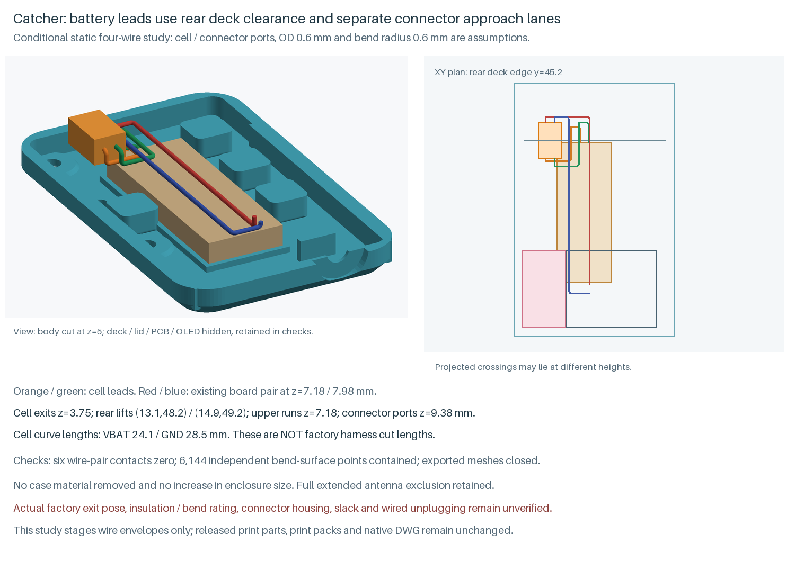

The preview hides the deck/lid/PCB/OLED and cuts the body for visibility; checks retain all of them. Cell curve lengths are about 24.1 and 28.5 mm, **not cut lengths**. No factory harness cutting or alteration is proposed. The model does not yet accommodate or retain all supplied cable slack, qualify the actual mated housing, or establish grip and wired opening/unplugging motion. Delivered exit geometry, insulation size/bend rating, physical component fit and printed strength remain unverified. Wider catcher cell leads are not qualified by this study. Printed material, outside size, STLs, 3MFs, drawing and both print packs remain unchanged.

## Verification and provenance

The current screw access and pilot stock also pass a separate check against serialized parts. M2.5 x 8 mm without a carrier and M2.5 x 10 mm with a carrier both give 2 mm nominal axial overlap into the boss and 2 mm below its blind pilot roof. The check reverses the carrier's print rotation before testing head entry, shaft clearance and the complete pilot annulus. Incorrect-length negative controls reproduce zero nominal overlap for 8 mm screws through a carrier and roof contact for the cylindrical 10 mm envelope without one. Actual thread engagement depends on the screw point, tolerances and printed material; torque and holding strength remain unmeasured.

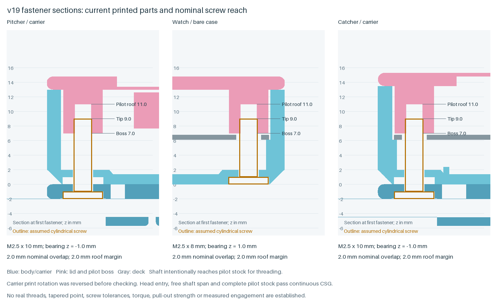

The [verification report](verification.json) records the current release and its original candidate evidence:

- All 14 audit scopes are covered by fresh changed-interface checks and proven unchanged-feature reuse, retaining existing collision, boundary, mesh and stock limits. The report distinguishes current scope from historical execution evidence.
- Full build checks pass for all 34 printed parts, fit coupon, color pairs and grouped 3MF files.
- The drawing contains 60 valid native solids, zero drawing audit errors and 78 empty modeled component/body/lid/deck intersections.
- All 34 raw native STL exports are watertight, consistently wound, single-shell and match both Boolean boundary directions under 0.1 mm³. No fan separation is used.
- The v20 drawing replaces two pitcher solids and moves its cell reference from a preserved copy of v19. All 60 solids, 78 nominal contacts and 34 raw boundaries were checked afresh. All 69 current STL files and six grouped 3MF shape/placement sets pass independent readback.
- Matching exports, current previews, instructions and both print packs are checked by content and checksum.

Canonical `cad/unbranded/exports` files remain the print release. Real component fit, joint/connector access, printed stiffness/strength, adhesive retention, antenna performance and hardware operation remain unmeasured. The untouched PCB SHA-256 is `c5d076c78378cedc2037873068e48ef9f81504e414bdea26183e06a1bf4b512f`; its source is the [Seeed XIAO resources](https://wiki.seeedstudio.com/xiao_nrf54l15_sense_getting_started/).

## CLI workflow

Maintainer source lives in `.tools/cad-source`; current native evidence is under `.tools/autocad/v20` and its original checked construction session is preserved in `.tools/cad-runs/v20-release-preparation/native`. Run `verify_v20_release.py` for the current release checks. The v20 publication snapshot contains source, evidence, guides and packs; earlier snapshots and drawings remain historical evidence. `autocad_rebuild_parts.json` lists sixteen CSG parts. Native scripts preserve their original isolated run paths; prepare fresh output paths before any future native construction.

The older individual audit scripts contain historical baselines and output paths. Do not rerun them into completed evidence directories or treat their old revision stamps as new measurements. Current v20 coverage binds each of their 14 scopes to changed-interface checks or proven geometry identity. Stage any new audit in a fresh directory, keep the established limits, inspect saved/native views, then publish matching sources, meshes, metadata, guides and both packs together.

Further available work is complete supplied-harness slack, retention and wired service motion, full Back/OLED/switch routing, and supported durability/weight iterations. Actual fit, printed strength, flashing, radio compatibility, range, latency and battery life remain unmeasured.
