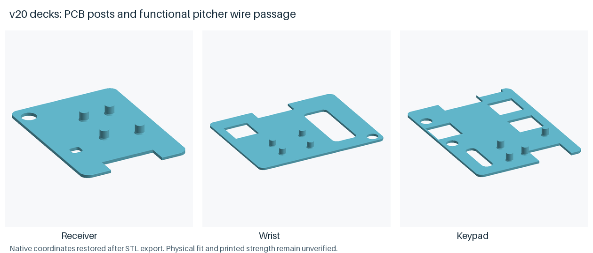
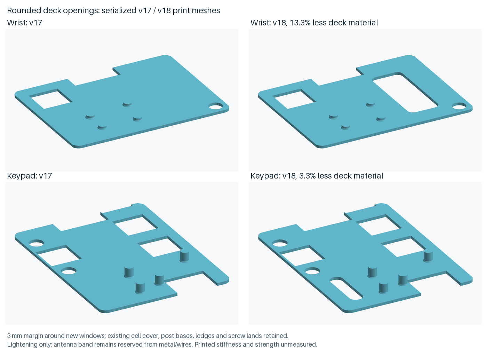

# Cases

This folder preserves print release `v20-pitcher-wire-clearance`. The current horizontal four-button catcher and captive battery panel are in the [v8 sliding-panel fit prototype](../prototypes/side-slider-v8/PRINT_AND_ASSEMBLY.txt). Its parts form a separate matched set. All dimensions here are in millimetres; use the v20 bodies, lids and decks together when inspecting this earlier release.

## Print list

| Unit | Sets | Files |
|---|---|---|
| Pitcher | 1 | `receiver_body`, `receiver_lid`, `receiver_deck`, `receiver_charge_cap`, `receiver_belt_carrier`, `receiver_plunger_1`, `receiver_plunger_1_head` |
| Catcher | 1 | `keypad_body`, `keypad_lid`, `keypad_deck`, `keypad_charge_cap`, `keypad_guard_carrier`, `keypad_plunger_call_1..4` and their `_head` parts, `keypad_plunger_back`, `keypad_plunger_back_head`, `keypad_label_call_1..4`, `keypad_display_bezel` |
| Shortstop | 1 | `wrist_body`, `wrist_lid`, `wrist_deck`, `wrist_charge_cap`, `wrist_plunger_1`, `wrist_plunger_1_head`, `wrist_display_bezel` |
| Center field | 1 | same as shortstop |
| Fit check | 1 | `exports/fit_coupon` |

The STLs are in `exports/`. Not printed: `*_color.stl` (same meshes for colour printers), `*_colored.3mf` and `*_lid_colored.3mf` (grouped print files), and the previews. Screws, webbing, wire, cells, and headphones are in the [parts list](../../docs/bom.md).

There are 7 parts per pitcher, 20 per catcher and 7 per fielder: 41 unit parts for the full team, or 27 for the catcher/pitcher bench set, plus the fit coupon. Each control now has a separate captive stem and head. Use the current stems, heads and lids together; the catcher also needs the current body for its aligned Back guide and switch stop.

The 0.85 mm heads sit 0.2 mm below the surrounding surface and leave 0.35 mm of inward clearance: nominal 0.25 mm switch travel plus 0.1 mm reserve. The flanges retain the stems under the guide floors. The switch collars clear the nominal 6 mm square bodies, and the Back switch has a rear bearing stop. Exported meshes have been checked through continuous conservative travel and assembly sweeps; printed movement, adhesive-joint retention and strength remain untested.

The four `keypad_label_call_*` files are now connected numeral inlays, without a covering backplate. Print contrasting colours for the white numbered heads and cyan numerals. Each 0.4 mm numeral fits its matching 0.4 mm deep pocket from the front, seated on the floor and flush with the head face, with 0.1 mm edge clearance for adhesive. Use matching current heads and inlays; the previous pixel-slot heads and backed labels do not form this interface. The head retains 0.45 mm of material below the lettering pocket over its stem socket. Readability and clearance have been checked on the rendered and exported geometry; printed detail, fit and adhesive retention remain untested.

The internal decks now follow the rounded tray cavities with 0.2 mm nominal edge clearance. Their 0.1 mm edge bevels leave flat bearing lands on both ledges, whose tops meet the deck undersides. Use matching current bodies and decks; the older decks overlap the tray walls and the watch cavity corners. Continuous insertion checks on exported meshes clear those walls, but printed seating and flex still need testing.

The current wrist and keypad trays include 0.15 mm nominal relief around the reserved PCB/header insertion paths, and the wrist also clears its OLED envelope. Small exterior corner ramps preserve a 1.2 mm upper wall section at the relieved corners. The PCB outline and board-relative USB footprint come from the manufacturer's KiCad file; the remaining component envelopes and mounting heights still require physical checks.

Revision v15 moves the boards to align that USB footprint with the ports and clear the caps. The catcher also raises its board, moves its cell and display, and rearranges its call buttons. Use the current bodies, lids and decks together, including the updated fit coupon. Compared with v14, calculated material decreases by 30.21 mm³ for the pitcher and 23.28 mm³ for the watch, and increases by 394.48 mm³ (about 2.3%) for the catcher. Only the catcher's height increases, by 0.8 mm; strap channels and fastening positions remain the same. These calculations do not establish printed fit or strength.

Revision v17 replaces the four lid pads over populated PCB footprints with four posts on the deck under the board. The posts have 2 mm tops and 2.4 mm widened bases; their tops meet the existing PCB underside datum. The manufacturer footprint review found that the former pads occupied reserved space for 20 front-side components in each style, including the antenna. The new layout clears 79 front courtyards per style at an assumed 2 mm height, and leaves 0.5 mm below the underside pads with 0.2 mm XY allowance. These are geometric reservations, not measured component or solder dimensions.

For the historical v18 revision, the v17 body, lid and PCB-support interfaces were retained; use the current matching print set. In v18, board height and outside dimensions were unchanged; the charging-footprint transverse offset is corrected to follow the same front-side orientation in every style. The catcher deck now extends under its board, and its Back-switch notch is centered on the switch. Pull access uses a 12 x 4 mm notch at the pitcher deck's front edge and the other decks' rear edges. The old broad charging notch is replaced by clearance around the actual cap envelope. Relative to v16, calculated material increases by 70.95 mm³ for the pitcher, 70.88 mm³ for the watch and 228.35 mm³ for the catcher. Printed stiffness, PCB retention, soldered fit and radio performance remain untested.

Revision v18 lightens the watch and catcher decks while retaining the v17 board posts, cell-cover stock, side-ledge contact, fastener lands and outside dimensions. The watch has an 8 x 20 mm rounded opening at x=29, y=7 mm; the catcher has a 3.2 x 12 mm opening at x=6, y=6 mm. Both use 1.5 mm corner radii and retain a 3 mm margin of existing deck stock around the new opening. Coordinates are in the case frame used by the source models, not the rotated print layout. The pitcher deck is unchanged.

Compared with v17, calculated deck material decreases by 13.3% (110.640 mm³) for the watch and 3.3% (25.520 mm³) for the catcher. These are lightening openings; keep metal and wiring out of the reserved antenna band. That historical v17-to-v18 upgrade replaced only the watch and catcher decks; use the v19 upgrade list below for the current release. Printed stiffness, durability and actual component fit remain unmeasured.

Revision v20 moves the pitcher cell reservation and its bay rails 1 mm toward the front and adds a 2.4 x 2.2 mm R0.6 wire passage in its deck at x=5.2, y=22.8. Replace the pitcher body and deck together when upgrading v19; the other 32 printed-part shapes and fit coupon are unchanged. Outside size, PCB/USB height, walls, floors, fastening and mounting stay the same. Calculated material changes by +1.296 mm³; actual mass and strength are unmeasured. The small functional passage retains the checked 3 mm stock margin and cell-cover/post/ledge/screw lands. Large lightening openings keep R1.5 corners.

The pitcher four-wire model clears assumed 0.6 mm insulated cell leads with R0.6 centerline bends, alongside the existing board-side pair. Watch and catcher conditional four-wire studies also pass at their documented assumed sizes. These are short geometric paths: they do not accommodate all supplied factory lead length or establish retention, soldered fit, unplugging or wired case opening. No factory harness cutting is proposed. Wider pitcher cell leads are unqualified.

The preceding v19 revision enlarged the protected-cell reservation to 12.7 x 32.4 x 4.3 mm, covering the supplier-linked older 12.3 x 32 x 4.3 mm maximum envelope with 0.2 mm XY allowance per side and 0.2 mm beneath the deck. That drawing has not been verified against the current delivered cell. The pitcher bay keeps its left edge to protect a screw bearing; the watch bay moves away from its front wall; the catcher pack moves 0.4 mm right to clear call 1.

The pitcher and watch PCB-to-deck gaps are 2.05 mm, with 2.4 mm on the catcher. Board, USB opening and case height rise together. Pitcher/watch flat height is 14.8 mm (+1.8 mm versus v18); catcher is 15.3 mm (+0.5 mm). Calculated full-set material rises by 6.4%, 7.4% and 1.6% respectively. These changes provide modeled battery and wire space; printed durability and actual component fit remain unmeasured.

When upgrading v18, replace all three bodies and decks, the pitcher/watch lids, and the fit coupon with matching current parts. Keep each replacement set together. The catcher lid, charge caps, carriers, bezels, buttons and numeral inlays are unchanged prints. Seventeen of 69 STL files change, including their color copies; 52 remain identical. The pitcher/watch lid screw bosses extend down to the deck datum as their upper plates rise. Strap paths, screw positions, 1.4 mm floor, 2 mm walls and full screw bearings are retained.

Current rounded deck openings are 7.7 x 20 mm at x=29.3, y=7 on the watch and 3.2 x 12 mm at x=5.9, y=6 on the catcher, each R1.5 with 3 mm retained stock margins. Keep metal and wiring out of the antenna reservation; these openings do not authorize routing through that band.

## Pitcher pod

The pitcher body is 29.0 x 47.6 mm, 14.8 mm flat, with one 12 mm recall cap and a 45 mm belt carrier. The carrier extends to 48.6 mm along the strap width and adds 5.7 mm below the case back. Print the current body, lid, deck and carrier together: their outline and screw positions form a matching set. The previous 30.0 x 48.6 mm shell parts do not all interchange with this set.

All three bodies have tapered internal pads around the screw entries. These leave 1.0 mm of material above the head counterbores while retaining the 1.4 mm floor elsewhere. The pitcher and catcher carrier plates are 2 mm thick, with rounded lightening windows, 3 mm rails and webs, and 1 mm of bearing material above their screw-head recesses. Three case screws retain each carrier; openings through the outer loop faces provide screw and driver access. The tunnel side walls remain continuous. The revised geometry has been checked against the reserved component sizes; printed fit and durability still require bench checks.

The carrier rails now have junction landings that rise 1.0 mm into the plate and cover its lower bevel. They remove the narrow groove beside the strap entrances while retaining the open mouths, strap clearance, screw access and original overall size. In a sampled straight rail section above the older shallow joint, the pitcher carrier increases from 5.22 to 10.40 mm²; this is a geometric improvement, with printed strength still unmeasured. The carrier changes add about 27.70 mm³ for the pitcher and 9.50 mm³ for the catcher. Existing bodies, lids, decks and fastener positions remain compatible.

## Fielder watch

The fielder is a flat watch: 45.8 x 50.1 mm body, 14.8 mm flat, 55.1 mm lug to lug over two printed fixed bars (51.1 mm between bar axes). The bars are 4 mm and stand 2.2 mm off the case back, so a 20 mm NATO or single-pass strap threads under both; a standard 1.2 to 1.5 mm NATO fits with clearance, up to about 2.0 mm. There is no metal in the strap path. The 0.96 inch 128x64 SSD1306 module (PCB 27.3 x 27.8 mm) sits under the bezel window with its 21.74 x 10.86 mm active area centred; the 12 mm recall cap is beside the display on a 6 mm switch. Two M2.5 screws on the diagonal, driven from the case back, plus the lid lip close the watch.

Each outer lug root has a 1.5 mm tapered gusset that spreads its junction into the shell. The lower ramp follows the case-back bevel, and the gussets stay outside the 20 mm strap corridor without extending the lug-to-lug span. These are geometric reinforcements; printed strap fit and resistance to pulling or impact still need testing.

Revision v16 moves the watch recall control and its matching switch support 0.8 mm toward the charging-wall side. Its centre is x 8.7, y 26.4 mm. This leaves a continuous 0.8 mm separator between the circular button recess and display pocket, replacing their previous zero-width tangent. Use the current watch body, lid and deck together; the separate stem and head are unchanged. Outside size and calculated material volume remain essentially the same. The exported geometry is checked, but the printed separator's strength remains unmeasured.

## Catcher pod

The catcher is a landscape pod worn across the front of the leg guard: 37.0 x 58.2 mm body, 15.3 mm flat, 15.7 mm over the hood. Call 1 sits to the left of the display; calls 2–4 run along its right side. Their functions and wiring assignments are unchanged. The 0.91 inch 128x32 SSD1306 module is rotated 90 degrees so its 128-pixel axis runs along the pod. Its reserved module rectangle starts at x 11.2, y 20.0: glass window 7.6 x 26 mm under the bezel, module nested 0.5 mm from the flat face. The face is flat (tilt 0) with a printed hood bar just past the window's far edge. The USB-C port is in the x_max long wall.

| Call | Button centre x, y (mm) |
|---|---|
| 1 | 6.5, 30.5 |
| 2 | 28.4, 23.7 |
| 3 | 28.4, 35.4 |
| 4 | 28.4, 47.6 |

Fit the module with the 4-pin header at the y_min (front) end and the pixel top edge toward the x_min long edge, away from the call buttons. Worn with that x_min edge up, the text reads left to right when looking down the leg. The 25 mm strap wraps the thigh and threads both `in_line_y` carrier loops, which sit along the pod length; the carrier matches the pod outline and adds 5.7 mm below the case back. The 7 mm Back cap is a 6 mm side-entry switch in the y_min wall, reachable by the bare throwing hand. Three M2.5 x 10 mm screws along the x_min edge, driven through the carrier from the back, plus the lid lip close the pod.

The carrier tunnels reserve 25.6 mm for the catcher strap and 45.6 mm for the pitcher belt, with 2.5 mm clear height. The modeled fit check uses 2 mm thick webbing; check the actual strap on a printed carrier before field use.

## Print first

`exports/fit_coupon.stl` has a 64 x 72 x 3 mm base and an upright charge-port wall, for 13 mm overall height. Print it flat as exported. Orient the plate with the four small holes nearest you and the upright wall at the far end.

| Gauge | Position and use |
|---|---|
| Basic holes | Front row, left to right: 2.2 / 2.6 / 2.8 / 3.3 mm diameters. |
| Screw head | Next row, left: the square pocket on top leaves a 2 mm local plate. Insert the screw from underneath into the 5.6 mm diameter x 1 mm deep recess; the 2.8 mm shaft hole leaves 1 mm of bearing material. Check the actual head seats below the underside. |
| Driver access | Beside the screw-head gauge: a 6.2 mm through hole matching the carrier access openings. |
| Watch strap | First slot after the holes: 20.0 mm wide x 2.2 mm high. |
| Catcher strap | Middle slot: 25.6 mm wide x 2.5 mm high for nominal 25 mm webbing. |
| Pitcher belt | Long far slot: 45.6 mm wide x 2.5 mm high for nominal 45 mm webbing. |
| Charge cap | Insert the current cap into the upright wall from the outside, at the far edge of the plate. The wall uses the current port and flange recess; the seated cap face should stand 0.6 mm proud. The plug has nominal 0.3 mm radial interference. |

The slot geometry has been checked with nominal 2 mm thick straps. Printed clearances, cap retention and insertion force still need checking with the actual materials. The upright wall is a local port sample; it does not reproduce the full case's stiffness or body/lid seam. Check lid and cap fit on an actual matching body/lid pair before printing the full set.

## Boards

The cases are sized for the XIAO with its 1x7 male header strips soldered on the two 21 mm edges: 2.5 mm tall and 2.5 mm wide above the PCB, with the pins trimmed flush to the pad side and a 0.5 mm solder fillet allowance under the board. Run the bench phases with the pins intact; before the cased build, trim the pins flush with flush cutters. A trimmed board cannot plug into a breadboard again. A bare board uses the same post-top datum. The 0.5 mm allowance clears trimmed solder fillets; it is not a shim thickness. Adding a shim or tape beneath the bearing surfaces raises the PCB and changes charging-port alignment. Check the actual soldered board and connector before retaining it.

The battery connections and catcher Back signal are on the PCB underside. In the manufacturer file, TP9 is BAT+ (VBAT), TP10 is BAT- (GND), and TP15 is Back (D13/P2.10). The Back lead must be soldered before the PCB is secured; the two standard 1x7 headers do not expose D13. File reference names are not assumed silkscreen labels.

The calculated PCB-to-deck space is 2.05 mm on the pitcher/watch and 2.4 mm on the catcher. Continuous CAD checks clear assumed 0.6, 1.0 and 1.4 mm insulated wire envelopes plus 0.05 mm per side from the underside pads to just outside the PCB, keeping other solder spaces, posts and the antenna band reserved. These paths do not establish soldered fit, bends, a complete wiring route, connector fit or strain relief. Measure the actual insulation and finished joint; AWG alone does not specify their outside size. Keep leads out of the antenna band and off the post bearings. Do not raise the board with a shim to make room.

## Settings

- PETG; ASA for hot cars or full sun.
- 0.2 mm layers, 0.25 mm first layer, 4 perimeters, 5 top/bottom layers, 25 % gyroid.
- No supports. Bodies print floor down; carriers print with the outer loop faces on the bed and the case-facing plate up, as exported. The watch prints case-back and lug arms down; its fixed bars bridge the strap channel above the bed. Lids print deck up. Charge caps print flange down. Button stems print flange down; separate button heads print face down with their socket sleeves up. Use the exported orientations.
- If the lid plate sags between the collars or over the catcher display window, add tree supports under the plate only.
- Numeral inlays print flat on their backs. Use a 0.2 mm first layer and 0.2 mm layers for their 0.4 mm thickness; check that the slicer preserves the complete 1.05 mm strokes. Keep their front faces flat so they seat flush.

## Assemble one unit

1. Leave the cell disconnected while soldering and during every USB-powered setup step. With the PCB underside accessible, solder the Adafruit 3814 male mating pigtail and the catcher Back (D13) lead; also solder the switch wires and trim the switch legs. Check polarity, finished joints and lead routing before fixing the board to the deck. Retain the cell's connector for external charging. The full mated housing and strain relief need checking with the actual parts.
2. Before fitting the switches, insert each face-button stem through its guide from inside the detached lid, leaving its flange underneath the guide floor. For Back, with the catcher body open and the deck removed, lower the stem into the pocket 1.5 mm behind its final position, then slide it toward the front wall into the guide. From outside, fit the matching `_head` onto the stem's post. The socket has nominal 0.05 mm radial clearance and 0.65 mm engagement; bond this joint with a small amount of adhesive compatible with the filament. Keep adhesive out of the moving guide and let it cure. Check that each assembled button slides freely, returns when supported by its switch and stays captive. Fit each face switch into its collar beneath the stem; the catcher Back switch enters its wall pocket from the open top and rests against the rear stop. Check the actual switch and joint on one unit before printing the full set.
3. Seat each numeral on the floor of its matching numbered head pocket from the front; it should be flush with the head face. Bond it with a small amount of filament-compatible adhesive in the edge clearance. Keep the pocket floor clear so a layer of glue does not raise the numeral above the face. Let it cure and recheck free button travel. Match the current layout: call 1 left of the display, calls 2–4 along its right side.
4. Tape the OLED into the lid recess, screen toward the bezel window. On the catcher, the header goes at the y_min end and the pixel top edge toward the x_min long edge.
5. Tape the cell into the bay. Route the pigtail and protected lead end away from the board antenna end. Keep the connector accessible when the deck is lifted, without pulling on a solder joint or the pouch leads; the current model has not established complete connector access. Unplug USB before connecting the cell.
6. Lower the matching current deck straight into the open tray over the cell and rest it flat on both side ledges. Its outline follows the rounded cavity with 0.2 mm nominal edge clearance. The deck must seat without bending or forcing it past a wall; test one printed body/deck pair first.
7. Rest the trimmed PCB on all four deck posts, component side toward the lid and USB end toward the matching wall opening. The posts rise 2.05 mm above the deck on the pitcher/watch and 2.4 mm on the catcher. Secure the board to the deck with a small amount of removable, filament-compatible adhesive beside the bearing tops, keeping the PCB resting directly on the posts. Keep adhesive off solder pads and test points. Retention and charging alignment must be checked with the actual board; do not fasten it to the former lid-pad locations.
8. Fit the lid onto the body and turn the case over. For a pitcher or catcher with a carrier, align the carrier's three holes with the case fasteners and drive three M2.5 x 10 mm screws through the access openings into the carrier counterbores. These screws clamp the carrier, body and lid together. Use three M2.5 x 8 mm screws for a pitcher or catcher without a carrier, or two for the fielder watch. Snug only. Do not use 8 mm screws through a carrier or 10 mm screws without one. The current CAD gives the specified lengths 2 mm of nominal axial overlap into the pilot boss and 2 mm of space below the blind pilot roof. A real screw's tapered point reduces its fully threaded engagement; actual screw dimensions and printed holding strength still need checking.
9. Press the matching charge cap into its recess, leaving its outer face 0.6 mm proud of the port wall. The exposed edge provides removal access.
10. Strap up: thread the belt or guard strap through both loops on the attached carrier. The fielder watch takes a 20 mm NATO threaded under both printed bars.
11. To open a case, remove the strap first. Undo the screws through the carrier access openings (or from the watch back), lift off the carrier, then lift the lid while allowing for its switch/display wires. The PCB remains on the deck; lift the deck using its end notch when access to the cell is needed.

## Wear

- Pitcher: belt carrier, or a pocket. One button, either hand.
- Fielder: 20 mm NATO watch strap, either wrist. One button, bare hand.
- Catcher: 25 mm guard carrier across the leg guard, strap wrapping the thigh. Four calls plus Back, bare throwing hand only.

## Charge

The specified [100 mAh cell](https://www.adafruit.com/product/1570) permits at most 100 mA charging; the [XIAO schematic](https://files.seeedstudio.com/wiki/XIAO_nRF54L15/Getting_Start/nRF54L15_Schematic.pdf), sheet 4, sets its USB-powered charger to 200 mA. **Disconnect the cell before any USB connection to the board**, including flashing, diagnostics and bench use. Charge the cell separately, off the player, using the [Micro-Lipo 1304](https://www.adafruit.com/product/1304) at 100 mA. Do not select its 500 mA setting.

To charge, unplug USB, remove the unit from the player and follow assembly step 11 to open the case. Support the lid, deck and attached wiring, then unplug the cell's connector from the board pigtail. Connect the disconnected cell alone to the external charger. After charging, remove it from the charger and reconnect it to the board with USB still unplugged. Close the unit using the matching parts. Do not pull the pouch leads or pinch the connector. Actual connector access and repeated opening remain unverified.

The existing USB port is for board setup and bench operation with the cell disconnected. Use the matching current body, lid and charge cap together: both case halves share the cap recess. The cap has a 12 x 5 mm flange seated 0.6 mm into the wall and a 1 mm hollow plug with a rounded lead-in. Its outer face stands 0.6 mm proud for removal; pry at the exposed edge. The cap covers the port, but printed fit, retention force and water resistance have not been tested.

The manufacturer USB1 footprint's reserved courtyard front is recessed about 1.82 mm behind the pitcher/watch wall and 1.72 mm behind the catcher wall. The model uses the footprint description's 3.25 mm height and an assumed 0.1 mm mounting offset above the PCB. The courtyard is a reserved footprint rather than a measured connector mouth. Check the actual connector, soldered board and cable insertion through a printed body/lid pair before using these cases.

## Cells

The slim shells are sized for a protected 100 mAh pouch, Adafruit 1570 class, 11.5 x 31 x 3.8 mm. The older 500 mAh (29 x 36 x 4.75 mm) and 850 mAh (34.5 x 45 x 6.2 mm) cells do not fit these cases; that cell class needs the older, larger shell set.

Those sizes are nominal product-page dimensions. The supplier-linked [2014 pack drawing](https://cdn-shop.adafruit.com/product-files/1570/1570datasheet.pdf), page 5, describes a 105 mAh LP401230 with its protection circuit at the lead end, dimensions 12 +/- 0.3 x 30 +/- 2 x 4 +/- 0.3 mm. Its relationship to the current 100 mAh product is unverified; the present CAD does not certify this larger tolerance envelope. Measure the delivered protected pack and full mated connector before printing a team set. The genuine JST PHR-2 housing drawing also does not dimension the Adafruit 3814 compatible male housing or the complete connected pair.

The earlier v18 calculation at its former cell poses found rail overlap for that drawing's nominal pack and 0.3 mm vertical deck overlap for its maximum pack. The v19 bay and coordinated deck/body changes now clear the source-linked 12.3 x 32 x 4.3 mm maximum box, with 0.2 mm per-side XY allowance and 0.2 mm beneath the deck. Those geometric reservations do not establish which drawing describes the delivered pack, the full connector/lead package or foam compression.

## Check with calipers

- Board 21 x 17.8 mm with 1x7 header strips on the 21 mm edges (2.5 mm tall, pins trimmed flush, 0.5 mm fillet allowance below), OLED 36 x 12.5 mm (catcher) or 27.3 x 27.8 mm (fielder watch), cell 11.5 x 31 x 3.8 mm.
- Switches: 6 x 6 mm through-hole tactile, about 0.25 mm travel and 100 gf. Shipped class: 5 mm tall, Addicore AD140 / TE 1825910-6 or Adafruit 367, 3.6 mm body plus 1.4 mm button. The Omron B3F-1000 class (4.3 mm) also fits and sits 0.7 mm clear of its pedestal, so add a 0.7 mm shim under the body. Caps: call 10.5 mm, recall 12 mm, Back 7 mm.
- Pitcher pod: 29.0 x 47.6 mm, 14.8 mm flat; 45 mm belt carrier.
- Catcher pod: 37.0 x 58.2 mm, 15.3 mm flat; call 1 left of the display, calls 2–4 along its right side.
- Fielder watch: a 20 mm strap threads under both printed bars with the watch off the wrist.
- Case screws: M2.5 x 10 mm through a carrier, M2.5 x 8 mm without a carrier or in the fielder watch. Pitcher 3 (two top corners, one bottom-left), catcher 3 along the x_min edge at y 23.0 / 38.1 / 53.2 mm, fielder watch 2 on the diagonal. Screw heads must fit the modeled 5.6 mm diameter x 1.0 mm deep recesses; check actual head dimensions.
- Confirm that the actual USB-C cable fully mates through the wall opening; cable clearance and insertion remain unmeasured.
- Screw heads fit the counterbores in the case back; webbing fits the coupon slots.
